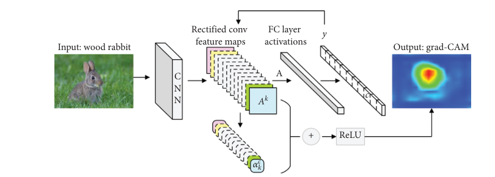
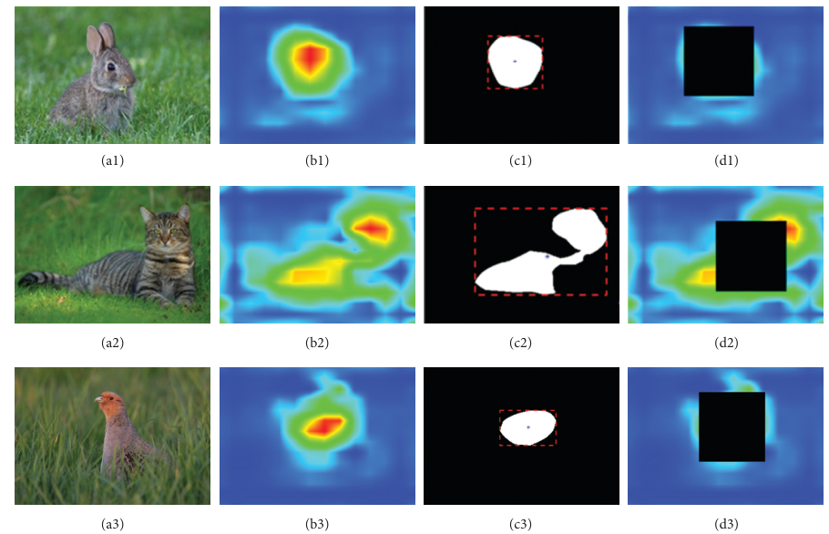
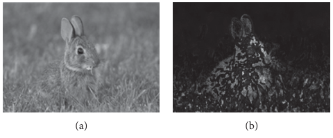
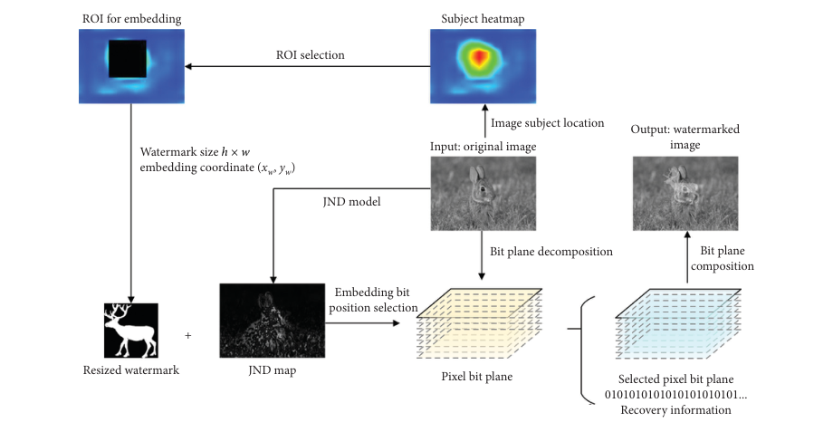
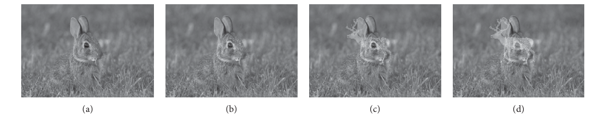
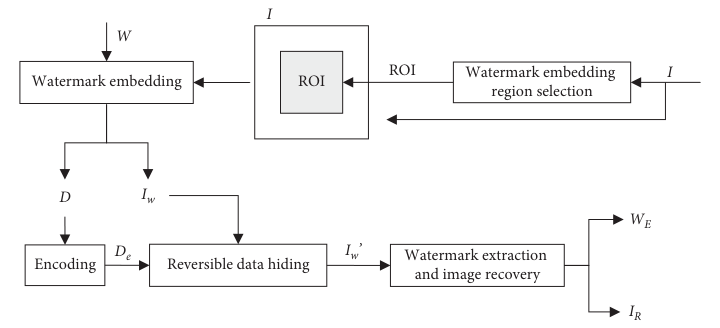
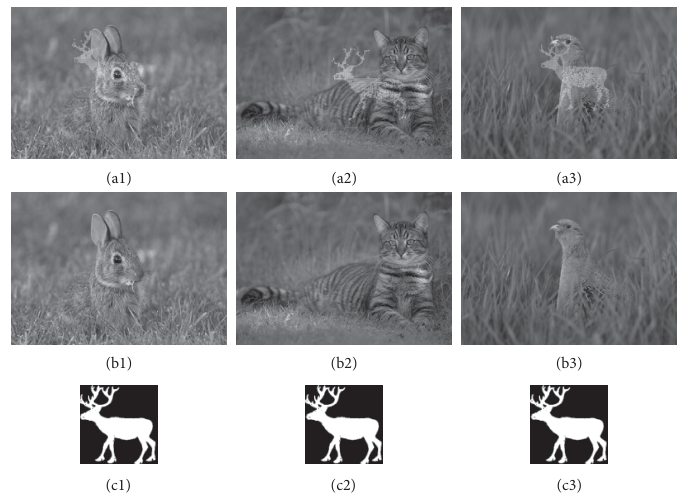

# Odwracalny widoczny znak wodny

## Grad-CAM i JND: algorytm krok po kroku

**Artykuł:** Jiasheng Qu i współautorzy, *A Novel Improved Reversible Visible Image Watermarking Algorithm Based on Grad-CAM and JND*, 2021.

**Czasopismo:** Security and Communication Networks.

**Cel:** umieścić widoczne logo na głównym obiekcie zdjęcia i umożliwić późniejsze odzyskanie dokładnych wartości oryginalnych pikseli.

1. Grad-CAM: obliczenie gradientów i mapy istotności.
2. ROI: wybór obszaru osadzania logo.
3. JND: oszacowanie progów zauważalnej zmiany jasności.
4. Osadzenie logo i zapis danych naprawczych.
5. Odczyt logo i odzyskanie oryginalnego obrazu.
---

## 1. Gradienty cech i mapa Grad-CAM



*Rysunek 1 z artykułu. Kolory po prawej pokazują obszary wspierające rozpoznanie królika.*

1. Podajemy zdjęcie do gotowej sieci **VGG-16**, wytrenowanej na ImageNet.
2. Wybieramy klasę obiektu, np. „królik”, i jej wynik przed softmaxem: $y^c$.
3. Obliczamy gradient wyniku względem aktywacji ostatniej warstwy konwolucyjnej: $\partial y^c/\partial A^k_{ij}$.
4. Uśredniamy gradienty przestrzennie. Otrzymujemy wagę $a_k^c$ każdej mapy cech.
5. Sumujemy ważone mapy cech, stosujemy ReLU i powiększamy wynik do rozmiaru zdjęcia.

$$
a_k^c=\frac{1}{Z}\sum_{i,j}\frac{\partial y^c}{\partial A^k_{ij}},
\qquad
L^c=\operatorname{ReLU}\left(\sum_k a_k^c\,A^k\right)
$$

**Wynik:** zgrubna mapa obszarów ważnych dla wybranej klasy. Gradienty służą do analizy decyzji sieci, bez ponownego treningu modelu.

---

## 2. Wybór obszaru ROI



*Rysunek 2 z artykułu. Kolumny: zdjęcie, mapa Grad-CAM, binaryzacja, kwadrat przeznaczony na znak.*

1. Przedstawiamy mapę Grad-CAM w palecie **jet**.
2. Pobieramy czerwony kanał tej wizualizacji i binaryzujemy go.
3. Wybieramy największy spójny obszar i obliczamy jego środek geometryczny.
4. Wokół tego środka ustawiamy **kwadratowe ROI** i dopasowujemy do niego logo.

Rozmiar kwadratu zależy od wymiarów zdjęcia i parametru $r$. Większe $r$ daje mniejsze logo. Autorzy dobierają bok jako wielokrotność $2l$, gdzie $l=3$ jest bokiem bloku.

**Przykład z artykułu:** zdjęcie królika $675\times477$, $r=2$, logo $240\times240$.

**Wynik:** współrzędne lewego górnego rogu $(x_w,y_w)$ oraz rozmiar $h\times w$. Znak trafia na główny obiekt, co utrudnia jego proste wykadrowanie.

---

## 3. Mapa progów JND



*Rysunek 5 z artykułu. Po lewej zdjęcie, po prawej mapa JND. Jaśniejsze miejsca oznaczają większe progi.*

**JND określa, jak duża zmiana jasności zaczyna być zauważalna w danym miejscu.** Mapa ma jeden próg $T_{\mathrm{JND}}(i,j)$ dla każdego piksela.

Model analizuje lokalną jasność i maskowanie przez strukturę obrazu. Wykorzystany model Wu i współautorów uwzględnia kontrast oraz złożoność wzoru, ocenianą przez różnorodność lokalnych kierunków zmian jasności.

| Umowny przykład | Zmiana jasności | Próg JND | Przewidywany efekt |
| --- | ---: | ---: | --- |
| Gładkie tło | 6 | 2 | Zmiana łatwiej zauważalna |
| Złożona tekstura | 6 | 12 | Zmiana łatwiej zamaskowana |

Próg jest oszacowaniem percepcji. W tym algorytmie służy do znalezienia zmian wystarczająco silnych, by białe fragmenty logo były widoczne.

**Wynik:** mapa lokalnych progów. Parametr $\alpha$ skaluje je przy osadzaniu, a $\beta$ określa wymagany poziom widoczności bloku.

---

## 4. Osadzanie logo w bitach obrazu



*Rysunek 4 z artykułu. ROI ustala położenie logo, a JND pomaga dobrać pozycje bitowe.*

1. Dzielimy binarne logo i ROI na odpowiadające sobie bloki **3×3**.
2. Dla każdego bloku sprawdzamy kandydatów $\theta\in\{1,\ldots,7\}$.
3. Klucz generuje dla każdego piksela bit $d$. Faktyczna pozycja to $m=\theta$ dla $d=1$ albo $m=\theta-1$ dla $d=0$.
4. Na pozycji $m$ ustawiamy odpowiedni bit logo $\delta$: 0 lub 1.
5. Obliczamy błąd kwadratowy zmian. Dla białego bloku wybieramy najmniejszy błąd spośród kandydatów spełniających warunek widoczności oparty na JND. Dla pozostałych bloków minimalizujemy sam błąd.

$$
\widetilde p=p-b_{\mathrm{original}}\,2^m+\delta\,2^m
$$

**Wspólny parametr $\theta$ dotyczy bloku. Wartość logo i wybór między $\theta$ a $\theta-1$ dotyczą poszczególnych pikseli.** Piksel zachowuje jasność, jeśli wskazany bit już ma wymaganą wartość.

Zgodnie ze wzorem (9), biały blok zawiera dziewięć jedynek. Bloki mieszane także należą do kategorii minimalizującej sam błąd.

---

## 4a. Przykład zmiany jasności



*Rysunek 11 z artykułu. Od lewej: oryginał, następnie $\beta=0{,}3$, $0{,}5$, $1$, przy stałym $\alpha=1$.*

Weźmy piksel zdjęcia o jasności **150** i odpowiadający mu biały piksel logo, czyli $\delta=1$.

```text
Oryginalna jasność: 150 = 10010110

Ustawienie bitu o wadze 8:  10011110 = 158, zmiana +8
Ustawienie bitu o wadze 32: 10110110 = 182, zmiana +32
Ustawienie bitu o wadze 64: 11010110 = 214, zmiana +64
```

Jeśli słabsze warianty nie spełniają warunku widoczności bloku, a wariant ze zmianą +32 go spełnia i daje najmniejszy dopuszczalny błąd, wybieramy ten wariant.

Warunek ocenia cały blok. Dla każdego piksela porównuje zmianę z $\alpha T_{\mathrm{JND}}$, przelicza ją funkcją $g$ na wynik od 0 do 1 i wymaga średniego wyniku co najmniej $\beta$. Wzory (12)–(14) opisują tę ocenę.

**Jedynka logo ustawia wybrany bit na 1.** Wartość piksela wzrasta tylko wtedy, gdy ten bit wcześniej wynosił 0.

---

## 4b. Dane potrzebne do odwrócenia zmian



*Rysunek 3 z artykułu. Gałąź D przechowuje informacje do cofnięcia zmian, a gałąź Iw zawiera obraz z widocznym logo.*

Zachowujemy:

- położenie i rozmiar logo,
- wybraną wartość $\theta$ dla każdego bloku,
- oryginalny bit z faktycznie nadpisanej pozycji każdego piksela ROI.

Następnie kompresujemy dane kodowaniem arytmetycznym, zabezpieczamy je przez XOR z sekwencją generowaną z klucza i osadzamy przez **Reversible Data Hiding (RDH)**. Autorzy wykorzystują metodę rozszerzania par błędów predykcji Ou i współautorów.

RDH umożliwia późniejszy odczyt danych i dokładne cofnięcie własnych modyfikacji obrazu. Musi mieć wystarczającą pojemność, żeby pomieścić dane naprawcze.

**Macierz wyborów $d$ odtwarzamy z klucza. Tajny klucz pozostaje poza danymi naprawczymi osadzonymi w obrazie.**

**Wynik:** końcowy obraz z widocznym logo i ukrytymi danymi umożliwiającymi odzyskanie oryginału.

---

## 5. Usuwanie znaku i odzyskiwanie oryginału



*Rysunek 16 z artykułu. Górny rząd: obrazy z logo. Środkowy: odzyskane zdjęcia. Dolny: odczytane znaki.*

1. Odwracamy RDH. Otrzymujemy dane naprawcze i dokładny obraz po samym osadzeniu widocznego logo.
2. Odtwarzamy sekwencję z właściwego klucza, wykonujemy XOR i dekompresujemy dane.
3. Odczytujemy położenie logo i wartości $\theta$. Klucz odtwarza wybory $d$, więc znamy faktyczne pozycje $m$.
4. Odczytujemy bit z pozycji $m$. To piksel odzyskiwanego logo: $\delta$.
5. Zastępujemy go zapisanym oryginalnym bitem. Odzyskujemy piksel zdjęcia.

$$
p=\widetilde p-\delta\,2^m+b_{\mathrm{original}}\,2^m
$$

**Przykład:** po osadzeniu mamy 182, pozycję $m=5$, odczytaną jedynkę logo i zapisany oryginalny bit 0:

$$
182-1\cdot32+0\cdot32=150
$$

Oryginalny bit mógł też wynosić 1. Dlatego przywracamy zapisane wartości zamiast automatycznie zerować bity. Osobny plik logo nie jest potrzebny.

**Warunek dokładnego odzyskania:** poprawny klucz i nieuszkodzony obraz wynikowy. Po kompresji JPEG lub filtracji logo może pozostać widoczne, ale bezstratne odzyskanie oryginału nie jest gwarantowane.
