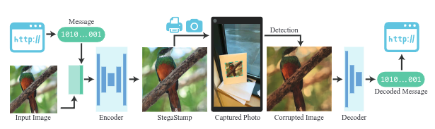
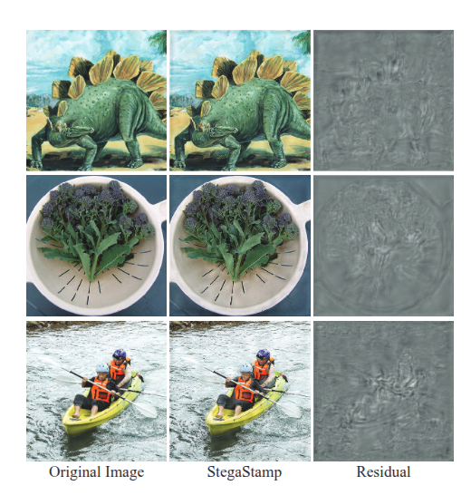
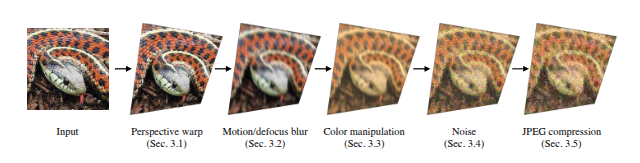
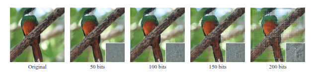

# StegaStamp: niewidoczne hiperłącza w fizycznych fotografiach

## Algorytm i trening krok po kroku

**Artykuł:** Matthew Tancik, Ben Mildenhall, Ren Ng, *StegaStamp: Invisible Hyperlinks in Physical Photographs*, 2020.

**Konferencja:** CVPR 2020 (UC Berkeley).

**Cel:** ukryć w zdjęciu krótki ciąg bitów reprezentujący hiperłącze w sposób niemal niezauważalny dla człowieka, a jednocześnie odporny na wydruk, wyświetlenie na ekranie i ponowne sfotografowanie.

1. Przepływ systemu: enkoder, transmisja fizyczna, detektor i dekoder.
2. Enkoder: osadzanie 100-bitowej wiadomości jako rezyduum obrazu.
3. Symulacja zniekształceń fizycznych podczas treningu.
4. Funkcja straty, kryterium jakości i stabilizacja treningu.
5. Detekcja, dekodowanie, korekcja błędów BCH i długość wiadomości.

---

## 1. Przepływ systemu

*Rysunek 1 z artykułu. System łączy wspólnie trenowany enkoder i dekoder z osobnym detektorem lokalizującym zdjęcie w kadrze.*

1. Hiperłącze kodujemy do krótkiego ciągu bitów (analogicznie do skracaczy URL), zabezpieczonego kodem korekcji błędów **BCH**.
2. **Enkoder** przyjmuje zdjęcie $400\times400$ oraz 100-bitowy ciąg i zwraca obraz StegaStamp.
3. Obraz zostaje wydrukowany lub wyświetlony na ekranie, a następnie sfotografowany aparatem.
4. **Detektor** (dostrojona sieć segmentacji semantycznej **BiSeNet**) wyznacza czworokąt otaczający zdjęcie i prostuje go homografią do $400\times400$.
5. **Dekoder** odczytuje bity wiadomości, a korekcja BCH pozwala bezbłędnie odzyskać **56 bitów** użytecznego identyfikatora.

**Wynik:** niezauważalny odpowiednik kodu QR działający w świecie fizycznym — 56 bitów wystarcza do nadania unikalnego adresu każdemu zdjęciu w internecie.

---

## 2. Enkoder i rezyduum obrazu

*Rysunek 2 z artykułu. Kolumny: oryginał, obraz StegaStamp ze 100-bitową wiadomością oraz dodane rezyduum.*

1. 100-bitowa wiadomość przechodzi przez warstwę w pełni połączoną do tensora $50\times50\times3$, a następnie jest skalowana w górę do $400\times400\times3$.
2. Rozszerzoną reprezentację wiadomości łączymy ze zdjęciem RGB ($400\times400$) i podajemy na wejście enkodera o architekturze **U-Net**.
3. Enkoder nie generuje całego obrazu od zera — wylicza wyłącznie 3-kanałowe **rezyduum** dodawane do oryginału.
4. Zmiany są najsilniej skupione w obszarach o bogatej teksturze, gdzie ludzki wzrok trudniej je dostrzega.

**Ograniczenie z artykułu:** w dużych, gładkich regionach o niskiej częstotliwości rezyduum bywa subtelnie zauważalne.

---

## 3. Symulacja zniekształceń fizycznych

*Rysunek 3 z artykułu. Pięć kolejnych, różniczkowalnych perturbacji przybliżających proces wydruku i fotografowania.*

Aby uniknąć ręcznego fotografowania milionów par treningowych, między enkoderem a dekoderem wstawiono **różniczkowalny potok perturbacji**:

1. **Zniekształcenie perspektywiczne (homografia):** losowe przesunięcie 4 narożników do $\pm 40\text{ px}$ ($\pm 10\%$) i dwuliniowe przepróbkowanie.
2. **Rozmycie ruchem i nieostrość:** filtr liniowy o losowym kącie (szerokość $3\text{–}7\text{ px}$) lub rozmycie Gaussa ($\sigma\in[1,3]\text{ px}$).
3. **Manipulacja kolorem:** przesunięcie kanałów RGB o $[-0{,}1,\,0{,}1]$, losowa desaturacja oraz afiniczne skalowanie jasności i kontrastu $mx+b$ ($m\in[0{,}5,\,1{,}5]$, $b\in[-0{,}3,\,0{,}3]$).
4. **Szum matrycy:** addytywny szum Gaussa ($\sigma\sim U[0,\,0{,}2]$).
5. **Różniczkowalna kompresja JPEG:** transformata DCT bloków $8\times8$ i przybliżenie kwantyzacji z niezerową pochodną (jakość z zakresu $[50, 100]$):

$$
q(x)=\begin{cases}
x^3, & |x| < 0{,}5 \\
x, & |x| \ge 0{,}5
\end{cases}
$$

**Kluczowy wniosek z ablacji:** zniekształcenia przestrzenne (perspektywa i rozmycie) są krytyczne — bez nich skuteczność po wydruku spada do poziomu losowego zgadywania.

---

## 4. Dekoder, funkcja straty i trening

**Dekoder:**
- Rozpoczyna się od sieci **Spatial Transformer Network (STN)**, która koryguje drobne błędy wyrównania po detektorze.
- Kolejne warstwy konwolucyjne, gęste i sigmoida zwracają 100 prawdopodobieństw bitów, uczonych stratą entropii krzyżowej $L_M$.

**Funkcja straty:** łączy odtworzenie bitów z minimalizacją zniekształceń wizualnych (na zbiorze **MIRFLICKR**):

$$
L = \lambda_R L_R + \lambda_P L_P + \lambda_C L_C + \lambda_M L_M
$$

- $L_R$ — regularyzacja $L_2$ rezyduum,
- $L_P$ — percepcyjna strata **LPIPS**,
- $L_C$ — strata krytyka (Wasserstein GAN) odróżniającego obrazy czyste od zakodowanych,
- $L_M$ — entropia krzyżowa odkodowanej wiadomości.

**Trzy zabiegi stabilizujące zbieżność:**
1. Wagi strat obrazu $\lambda_{R,P,C}$ startują od zera i rosną liniowo dopiero po osiągnięciu wysokiej dokładności dekodera.
2. Siła perturbacji również zaczyna od zera — najwolniej zwiększana jest perspektywa.
3. Waga straty $L_2$ rośnie na krawędziach obrazu (spadek cosinusowy), aby zniechęcić sieć do tworzenia widocznych artefaktów przy ramce.

---

## 5. Długość wiadomości i wyniki w świecie rzeczywistym

*Rysunek 8 z artykułu. Zwiększanie liczby bitów wymusza silniejsze rezyduum i obniża jakość wizualną.*

| Metryka | 50 bitów | 100 bitów | 150 bitów | 200 bitów |
| --- | ---: | ---: | ---: | ---: |
| **PSNR** $\uparrow$ | 29,88 | **28,50** | 26,47 | 21,79 |
| **SSIM** $\uparrow$ | 0,930 | **0,905** | 0,876 | 0,793 |
| **LPIPS** $\downarrow$ | 0,100 | **0,101** | 0,128 | 0,184 |

*Tabela 2 z artykułu (średnia z 500 obrazów, próg dokładności bitowej $\ge 95\%$). Długość 100 bitów daje najlepszy kompromis między jakością a pojemnością.*

**Ewaluacja rzeczywista (18 kombinacji: 3 drukarki + 3 ekrany $\times$ 3 aparaty, 1890 zdjęć):**
- **Średnia dokładność bitowa:** **98,7%** (mediana 100% w 2/3 scenariuszy).
- **Odporność na zasłonięcia:** mimo braku treningu na okluzjach, dekoder utrzymuje 97–99% poprawnych bitów przy częściowym zakryciu zdjęcia.
- **BCH:** przy $\ge 95\%$ poprawnych bitów kod BCH bezbłędnie odzyskuje 56-bitowe hiperłącze.
- **Główne wąskie gardło:** detektor BiSeNet wymaga pojedynczych, kwadratowych zdjęć i bywa ograniczeniem w nagraniach wideo.
