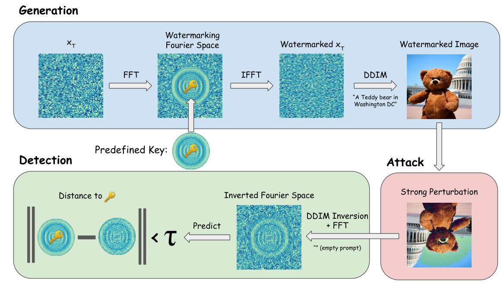
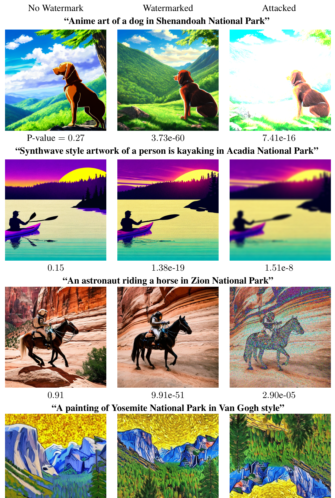

# Tree-Ring Watermarks: niewidoczne znaki wodne w obrazach dyfuzyjnych

## Algorytm i detekcja krok po kroku

**Artykuł:** Yuxin Wen, John Kirchenbauer, Jonas Geiping, Tom Goldstein, *Tree-Ring Watermarks: Fingerprints for Diffusion Images that are Invisible and Robust*, 2023.

**Źródło:** [arXiv:2305.20030, wersja 3](https://arxiv.org/abs/2305.20030v3), University of Maryland.

**Cel:** oznaczać obrazy już podczas generowania przez model dyfuzyjny i wykrywać ten znak również po przekształceniach obrazu, bez dodatkowego treningu modelu.

1. Przygotowanie początkowego szumu i klucza w dziedzinie Fouriera.
2. Osadzenie pierścieni i generowanie obrazu.
3. Inwersja DDIM: oszacowanie szumu na podstawie obrazu.
4. Detekcja: porównanie odzyskanego wzoru z kluczem.
5. Wyniki, odporność i ograniczenia.

---

## 1. Przepływ systemu

*Rysunek 1 z artykułu. Górna część przedstawia generowanie, dolna — detekcję po przekształceniu obrazu.*

1. Losujemy początkowy szum Gaussa $x_T$.
2. Obliczamy jego **FFT** i zastępujemy wybrane współczynniki przygotowanym kluczem.
3. Wykonujemy **IFFT**, otrzymując zmodyfikowany szum.
4. Gotowy model dyfuzyjny generuje z niego obraz, korzystając z samplera **DDIM** i ewentualnego promptu.
5. Przy detekcji odwracamy proces, obliczamy FFT oszacowanego szumu i szukamy klucza.

**Wynik:** znak jest częścią procesu generowania. Nie nakładamy logo ani dodatkowego rezyduum na gotowe zdjęcie.

---

## 2. FFT, maska i klucz pierścieniowy

**FFT przedstawia szum jako współczynniki częstotliwościowe.** Każdy współczynnik opisuje amplitudę i fazę określonej składowej przestrzennej. Po przesunięciu widma niskie częstotliwości znajdują się w jego środku.

1. Wybieramy **kołową maskę $M$** wokół środka widma.
2. Dzielimy ten obszar na koncentryczne pierścienie.
3. Dla każdego pierścienia losujemy wartość z rozkładu Gaussa i przypisujemy ją współczynnikom należącym do tego pierścienia.
4. Zapisujemy cały wzór jako klucz $k^*$, z którym później porównamy odzyskane widmo.

$$
F=\operatorname{FFT}(x_T),\qquad
F'_i=\begin{cases}
k_i^*, & i\in M,\\
F_i, & i\notin M.
\end{cases}
$$

**Dlaczego pierścienie?** Obrót sygnału odpowiada obrotowi jego widma. Wzór o stałej wartości na pierścieniu zachowuje strukturę przy obrocie, co pomaga wykrywać znak po obróceniu obrazu.

Pierścienie występują w **widmie początkowego szumu**, a nie jako widoczne okręgi na wygenerowanym obrazie. Odporność całego systemu zależy także od jakości inwersji.

---

## 3. Generowanie obrazu ze zmodyfikowanego szumu

Po IFFT otrzymujemy oznaczony szum, który podajemy do niezmienionego modelu dyfuzyjnego.

W **Stable Diffusion** operujemy w przestrzeni latentnej:

1. Startujemy od oznaczonego latentu $z_T$.
2. W każdym kroku **U-Net przewiduje szum** na podstawie bieżącego $z_t$, kroku czasowego i warunku tekstowego.
3. Aktualizacja DDIM wykorzystuje tę predykcję do wyznaczenia mniej zaszumionego $z_{t-1}$.
4. Po ostatnim kroku otrzymujemy $z_0$, który dekoder VAE zamienia na obraz RGB.

**Notacja:** artykuł używa ogólnego symbolu $x_t$. Dla Stable Diffusion odpowiada on latentowi $z_t$, a nie bezpośrednio pikselom zdjęcia.

**Bez dodatkowego treningu:** wykorzystujemy gotowy U-Net i VAE. Osadzanie polega na zmianie szumu wejściowego; nie trenujemy osobnego enkodera, dekodera wiadomości ani krytyka GAN.

Obraz z tym samym seedem i znakiem może mieć inny układ szczegółów niż wariant bez znaku. Niewidoczność oznacza brak rozpoznawalnego artefaktu znaku, a nie identyczność obu obrazów.

---

## 4. Inwersja DDIM: od obrazu do szumu

**Detektor dostaje obraz, ale nie zna pierwotnego szumu ani promptu.** Musi oszacować szum przy użyciu modelu generującego.

1. Dla Stable Diffusion kodujemy badany obraz enkoderem VAE do latentu $z'_0$.
2. Wykonujemy **inwersję DDIM**, przechodząc od małych do dużych poziomów zaszumienia.
3. W każdym kroku U-Net przewiduje składową szumową, a aktualizacja inwersji wyznacza bardziej zaszumiony latent.
4. Otrzymujemy przybliżenie początkowego szumu $\widehat z_T$.
5. Obliczamy jego FFT i odczytujemy współczynniki w masce $M$.

W głównym eksperymencie autorzy używają **pustego promptu** podczas inwersji, ponieważ tekst użyty przy generowaniu jest nieznany.

**Ważne:** inwersja jest przybliżona. Nie polega na dodawaniu świeżego, losowego szumu do obrazu. Kompresja, kadrowanie i błędy odwracania mogą oddalić odzyskany wzór od klucza.

---

## 5. Detekcja: odległość od klucza i próg

Porównujemy odzyskane współczynniki z zapisanym kluczem tylko w obszarze maski:

$$
d=\frac{1}{|M|}\sum_{i\in M}
\left|k_i^*-\operatorname{FFT}(\widehat x_T)_i\right|.
$$

1. **Małe $d$:** odzyskany wzór przypomina klucz.
2. **Duże $d$:** brak dostatecznej zgodności.
3. Uznajemy znak za wykryty, jeżeli $d<\tau$.

Próg $\tau$ dobieramy na obrazach oznaczonych i nieoznaczonych, kontrolując liczbę fałszywych alarmów.

Autorzy przedstawiają również **test statystyczny**: znormalizowaną sumę kwadratów różnic porównują z rozkładem niecentralnym $\chi^2$. Małe *p-value* wskazuje, że tak dobra zgodność z kluczem byłaby mało prawdopodobna przy przyjętej hipotezie braku znaku.

**P-value nie jest prawdopodobieństwem, że obraz wygenerowała AI.** Interpretacja testu zależy od założeń o rozkładzie odzyskanego szumu. Wariant testu z artykułu dotyczy kluczy Rand i Rings, a nie Zeros.

---

## 6. Warianty klucza i wyniki

| Wariant | Co osadzamy w masce? | Główna cecha |
| --- | --- | --- |
| **Tree-Ring Zeros** | Same zera | Prosta struktura odporna na przekształcenia, ale silniej zmienia rozkład szumu |
| **Tree-Ring Rand** | Jeden ustalony losowy wzór gaussowski | Mała zmiana jakości generowania; brak symetrii obrotowej |
| **Tree-Ring Rings** | Koncentryczne pierścienie o losowych wartościach | Symetria obrotowa i wysoka odporność w badanych warunkach |

**Stable Diffusion v2 — wyniki z tabeli 1:**

| Metoda | AUC bez ataków ↑ | Średnie AUC po atakach ↑ | TPR przy FPR = 1% po atakach ↑ | FID ↓ |
| --- | ---: | ---: | ---: | ---: |
| RivaGAN | 0,999 | 0,854 | 0,448 | 24,51 |
| Tree-Ring Rand | 1,000 | 0,918 | 0,702 | 25,47 |
| **Tree-Ring Rings** | **1,000** | **0,975** | **0,694** | **25,93** |

*FID modelu bez znaku: 25,29. Główne ustawienia: promień maski 10, po 50 kroków generowania i inwersji, guidance scale 7,5 przy generowaniu.*

Detekcję oceniano na 1000 oznaczonych i 1000 nieoznaczonych obrazach na przebieg; wyniki uśredniono po pięciu przebiegach. FID dla Stable Diffusion obliczano z 5000 wygenerowanych obrazów na przebieg.

**Interpretacja:** wysokie AUC opisuje rozdzielanie obu grup przy różnych progach. Przy konkretnym progu dającym 1% fałszywych alarmów Rings wykrywa średnio 69,4% oznaczonych obrazów po badanych atakach. Nie oznacza to stuprocentowej odporności.

---

## 7. Odporność i ograniczenia

*Rysunek 3 z artykułu. Kolejne wiersze pokazują zmianę jasności, rozmycie, szum Gaussa i obrót o 180°. Pod obrazami podano p-value.*

- **Badane przekształcenia:** obrót, JPEG, kadrowanie ze skalowaniem, rozmycie, szum i zmiany koloru. Odporność zależy od rodzaju i siły przekształcenia.
- **Dostęp do modelu:** detekcja wymaga parametrów modelu do inwersji oraz znajomości klucza. Sam obraz i klucz nie wystarczą.
- **Koszt detekcji:** trzeba wykonać wielokrokową inwersję dyfuzji, a nie tylko prostą analizę pikseli.
- **Sampler:** opisana metoda wykorzystuje DDIM; autorzy wskazują potrzebę adaptacji do innych schematów próbkowania.
- **Pojemność:** praca bada rozpoznawanie ustalonego klucza, bez dekodowania wiadomości bitowej takiej jak hiperłącze StegaStamp. Skalowalność do wielu kluczy pozostaje otwartym pytaniem.

**Wniosek:** Tree-Ring pozwala oznaczać generowane obrazy przez zmianę początkowego szumu, bez dodatkowego treningu. Wykrywalność po przekształceniach zależy od zachowania struktury klucza i dokładności inwersji.
